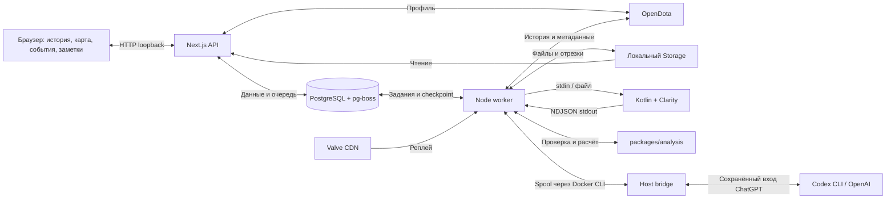

# Архитектура локального MVP Dota API

18 октября 2026 года, версия 1.18. Документ описывает **реализованный** контур
E00–E08, E12, E10, E13–E15. M3 принят для самостоятельного изучения матча;
M4 принят для просмотра с тренером — [протокол](iteration-acceptance.md).
[Команды запуска](../README.md) · [эксплуатация](local-operations.md) ·
[приёмка](mvp-acceptance.md) · [план](../tasks-plan.md).

## Назначение и границы

Один локальный пользователь выбирает профиль и матч, запускает скачивание или
импорт реплея, изучает всю игру и сохраняет наблюдения. Наличие автоматически
выбранных эпизодов не требуется. Детерминированные метрики, кандидаты эпизодов
и ручные оценки из E06/E07 сохранены как дополнительные инструменты.

Плавный просмотр E14 и AI-тренер E08 реализованы. Тренер запускается явно
через Codex CLI по подписке ChatGPT; без него просмотр матча продолжает работать.
E15 связывает неизменяемые отчёты с просмотром и ручной проверкой.
Сравнения/прогресс E09 и видео E11 остаются SKIPPED.
Публичное размещение, несколько пользователей, платежи, фоновое расписание,
Steam Game Coordinator и игровой 3D-движок не реализованы.

## Компоненты

E14: лёгкие наблюдения `motion-v1` хранятся в отдельных gzip-сегментах с
неизменяемыми ссылками; тяжёлые состояния и evidence сохраняют прежнюю
семантику. API `playback-v1` авторизует контекст и выдаёт 30-секундные окна.
Командный режим не читает полные ряды. Клиент держит до четырёх окон / 8 MiB
сериализованных данных, предзагружает соседние и очищает кэш при смене
контекста. Локальные часы и визуальные координаты не попадают в аналитику.
Подробный контракт, ограничение сглаживания и реальные замеры —
в [протоколе воспроизведения](playback.md).

| Компонент | Реализованная ответственность |
| --- | --- |
| `apps/web` — Next.js 16.4.0 / React 19.3.0 | Профиль/история, HTTP API, запуск/отмена/polling, полный просмотр, карта, заметки, ручные оценки и версии отчётов |
| `apps/worker` — Node 26.3.0 / TypeScript | История, источник/скачивание, распаковка, bounded JVM, нормализация, проверка покрытия и детерминированный анализ |
| `services/replay-parser` — Kotlin 2.4.20 / JVM 21 | Clarity 5.0.1 / protobuf 7.1; чтение `.dem`, метаданные, события и наблюдения |
| `packages/contracts` | JSON Schema 0.1.0, TS-типы/runtime-проверка, NDJSON 1.0.0 и совместимые валидаторы Kotlin |
| `packages/analysis` | Метрики, покрытие, маскирование перспектив, правила D01/D02/I01/F01 и отбор эпизодов |
| `packages/persistence` | PostgreSQL, миграции, неизменяемые снимки, индексы, локальный Storage и адаптер OpenDota |
| `packages/jobs` | pg-boss 12.37.1, workflow/checkpoint, надзор процессов, обработчики и DTO для HTTP |
| Host bridge + Codex CLI | Ограниченный запрос по подписке ChatGPT, сохранённый вход на хосте; JSON через Docker CLI без сетевого порта |
| PostgreSQL 18.6 | Профили/история/кеш, очередь, версии наборов, ссылки на файлы, заметки и история оценок |
| Storage volume | Проверенные реплеи, ручные входы, gzip-отрезки состояний; имена по SHA-256 |

Парсер — дочерний процесс, не отдельный HTTP-сервис. Один запрос NDJSON на stdin,
последовательность записей и терминальное complete/error на stdout; диагностика
отдельно. Общая схема встроена в дистрибутив CLI. `--check` сообщает способности
процесса, но не подтверждает доступность источника или поддержку любого реплея.

## Локальные изображения героев (E13)

Общий `HeroPortrait` и `hero-catalog.ts` используются картой игры/эпизодов,
списком под картой и таблицей участников. `HeroPreloads` загружает только
уникальные иконки участников; Next.js отдаёт хешированные PNG с immutable-кешем.
Неизвестный ID и ошибка изображения получают заглушку без изменения размера.
Координаты, маскирование перспектив и исходные состояния не изменяются.
Обновление каталога — отдельный явный скрипт; браузер не обращается к Valve CDN.
[Источники, обновление и проверки](hero-icons.md).

## Путь обработки

1. Web проверяет явный тип account ID / SteamID64 без потери точности и сохраняет
   профиль. Смена профиля не меняет участников прежних наборов.
2. Worker обновляет страницу истории через OpenDota. Кеш, Retry-After и результат
   запроса сохраняются отдельно от неизменяемых данных матча. Чтение истории
   не запускает скачивание реплеев.
3. Запуск создаёт запись workflow и pg-boss job одной транзакцией либо возвращает
   уже активный job матча. Закрытие браузера не отменяет работу.
4. `resolving` проверяет сохранённый файл, затем метаданные/ссылку источника.
   `downloading` получает архив, определяет none/bzip2/Zstandard по сигнатуре,
   ограничивает распаковку и проверяет Clarity, SHA-256, матч и участника.
   Ручной `.dem` проходит тот же путь; URL ещё не является артефактом.
5. `parsing` извлекает события и состояния, готовит неизменяемый dataset,
   parser_run, gzip-отрезки и индекс наблюдений. `validating` сохраняет отчёт
   пригодности с известным, частичным и неизвестным покрытием.
6. `analysing` выполняет детерминированные правила и сохраняет analysis_run и
   эпизоды. Готовый полный просмотр читает dataset независимо от analysisId.
   Этот этап не вызывает модель. По отдельному запросу создаётся версия `coach_runs`.
7. Web отдаёт паспорт, кадр, журнал с пагинацией и графики выбранного героя.
   Пользователь сохраняет заметку либо ручную оценку конкретного эпизода.

Статусы: queued → resolving → downloading → parsing → validating → analysing →
ready; отдельно unavailable, failed и cancelled. Недоступный реплей или новый
неуспешный разбор не скрывают ранее сохранённые данные.

## Транзакции, версии и файлы

Тяжёлая работа выполняется вне транзакции. Завершение этапа, его checkpoint,
ссылки на набор/артефакты и снимок задания публикуются атомарно. `boss.touch`
проверяет владение текущей попыткой; устаревший worker не может записать результат.
После остановки работа продолжается с первого незафиксированного этапа.
Задание, исчезнувшее на последней попытке, согласуется с состоянием очереди
при следующем чтении. Один тяжёлый обработчик на БД защищён advisory lock.

Fingerprint включает матч, участника, известный SHA-256 входа, версии парсера,
нормализации, правил, хеш методики со справочниками и настройки анализа.
Изменённые входы создают новую версию; неизвестный хеш не разрешает считать
старый результат актуальным. История прежних наборов не переписывается.

Файлы сначала пишутся в `.tmp`, затем атомарно публикуются под ключом SHA-256.
Доступ — по проверенным ID/ключам, не по произвольным путям. В БД сохраняются
хеш, размер и происхождение. Если процесс исчез между файлом и транзакцией,
может остаться непривязанный неизменяемый файл; автоматической сборки такого
мусора нет. Очистка удаляет только старые незавершённые `.part`, не готовые файлы.

SQL-миграции сериализованы advisory lock; хеш прежней миграции нельзя менять.
Сейчас 15 миграций приложения плюс схема pg-boss. Серверные workspace-пакеты
загружаются через native require: в runtime нужны также migrations, schema и
`.agents/skills/dota-match-analysis`. Их включает Docker-образ.

[Спецификация хранения](persistence.md) · [контракты](contracts.md) ·
[история/источники](profiles-and-history.md) · [импорт](replay-import.md).

## Время, перспективы и собственные записи

Основная шкала — игровые секунды относительно начала матча, включая отрицательное
время. Тики combat log, если не доказаны, равны null. Наблюдения берутся примерно
раз в 5 секунд и чаще вокруг смертей; кадр использует последнее наблюдение не
позже выбранного времени возрастом до 5 секунд. Пропуски не интерполируются.

Полный обзор явно назван ретроспективным. Для командной перспективы отдельные
DTO не читают полные состояния: неподтверждённый командный producer возвращает
unknown. Итоговая статистика и журнал полного обзора в этой перспективе скрыты.
Реальные сведения из будущего не выдаются за знания игрока.

Мировые координаты проверены, но подложка 7.40 приблизительная и может расходиться
с ориентирами до 9% ширины картинки. Точный рельеф и проходимость не заявляются.
Видимость, cooldown/canUse, границы боёв и роли остаются неизвестными. Есть
итоговая статистика и HP/мана; нет временных рядов золота, опыта и добиваний.
Неизвестное покрытие пропускает зависимое правило с объяснением.

`match_notes` хранит datasetId, accountId, героя, время, режим и текст. Повтор
одного ID идемпотентен; заметки неизменяемы и не переносятся на другой dataset.
Ручные оценки эпизода — отдельная версионная история с проверкой конкурентной
правки; подтверждение ошибки требует объяснения и альтернативы. Ни заметка,
ни оценка не переписывают исходный автоматический результат.

[Просмотр всей игры](match-explorer.md) · [эпизоды и оценки](episode-viewer.md) ·
[координаты](map-calibration.md) · [нормализация/покрытие](normalization.md) ·
[правила](analysis.md).

## Локальное выполнение и восстановление

Compose запускает PostgreSQL, одноразовый migrate, web и worker. По готовности БД
migrate применяет SQL, затем запускаются приложения. Только web публикует порт
на 127.0.0.1. Приложения работают от node, разделяют volume Storage, БД использует
отдельный volume. Секреты берутся из `.env`, не включаются в образ и backup.
OpenDota key необязателен; HTTP-прокси задаётся явно и исключает локальные адреса.

Web readiness проверяет БД, очередь и Storage; worker обновляет heartbeat после
аналогичной проверки. Ошибки idle-соединений БД не завершают процесс; успешные
новые подключения возвращают готовность. SIGTERM/SIGINT останавливают потребителя
и дочерний процесс; heartbeat удаляется. От внезапной смерти родителя JVM защищён
отдельным watchdog. Контейнерные лимиты: web/DB/worker — 1/1/3 GiB; JVM heap 1 GiB,
группа парсера 1.5 GiB, таймаут 120 секунд. Полные пределы — в документах jobs/import.

Логи связывают job/match/stage и фиксируют длительность, RSS Node worker и размер
артефакта. Исходные исключения с URL/паролями не печатаются. Логи ротируются.
RSS worker не равен пику JVM; замер памяти контейнера отдельно приведён в приёмке.

Backup останавливает писателей, проверяет ссылки БД, сохраняет dump, Storage и
фактический runtime-образ; manifest с хешами публикуется последним. Restore
разрешён только в новом проекте с новыми volumes: проверка хешей/архива,
pg_restore одной транзакцией, восстановление файлов, полный аудит и readiness.
Автоматического downgrade схемы нет; откат — восстановление прежней копии.
[Подробная процедура](local-operations.md), [реальные результаты](mvp-acceptance.md).

## AI-тренер и дальнейшее развитие

E08 использует отдельные неизменяемые `coach_runs`: контекст, снимок методики,
конфигурация, результат, usage и длительность. Общая очередь и advisory lock
ограничивают параллелизм. Лимиты запусков и request key предотвращают дубли;
неизвестный исход внешнего вызова не повторяется автоматически. Spool находится
в `.tmp/coach-bridge` Storage volume; фиксированные команды Docker передают
его host bridge. Codex запускается без инструментов и пользовательского config,
с watchdog. Авторизация не копируется в контейнер.

Числа и время берутся из проверенных фактов. Модель возвращает ссылки, гипотезы,
вопросы и действие; ответ проходит строгую проверку формата. Смена ручной оценки
помечает старый отчёт устаревшим без изменения текста. Семантика свободного текста
не имеет полной автоматической гарантии: [контракт](coach.md), [три контрольных отчёта](coach-quality.md).
E15 добавляет постоянную страницу reportId/datasetId/analysisId и проверку
принадлежности эпизода, времени, участника и SHA-256 оснований. Режим команды
не получает ретроспективный текст. Окна воспроизведения пересекаются с записью.
Миграция 016 связывает заметку с отчётом/эпизодом; оценки читаются по сохранённой
неизменяемой версии с автором и материалом. Заметки не передаются модели.
Перезапуск и backup/restore всех новых снимков проверены в E15:
[совместный просмотр](coach-viewing.md), [приёмка M4](iteration-acceptance.md).
Сравнения E09 требуют сопоставимых матчей и подтверждённых данных.

Новые патчи реплея, командный producer, точная подложка и дополнительные ресурсы
требуют самостоятельной проверки с явной версией. Исследования E01 сохранены:
[источники](data-source-validation.md), [скачивание](replay-download-validation.md),
[Clarity](replay-parser-validation.md), [матрица контекста](replay-capabilities.md).
Публичность исходников на GitHub не меняет локальную модель доступа приложения.
