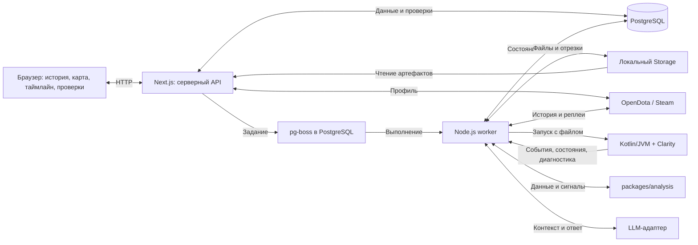

# Архитектура персональной аналитики матчей Dota 2

Дата: 12 октября 2026 года. Версия документа: 1.3. Задачи: E00-T01, E00-T02, E00-T03; планирование E00-T04.

Основания: [план задач](../tasks-plan.md), согласованный пользователем MVP и [skill dota-match-analysis](../.agents/skills/dota-match-analysis/SKILL.md). Документ описывает целевую архитектуру. В E00-T02 создан и проверен минимальный каркас: web, worker, Kotlin CLI и общие TypeScript-пакеты. Интеграции и разбор реальных реплеев пока не реализованы и не проверены.

Текущие команды и версии зафиксированы в [README](../README.md). Сборка использует npm workspaces с lockfile и Gradle Wrapper с проверкой SHA-256; локально подтверждены проверка типов, сборка и пять проверок запуска на macOS arm64. Web содержит стартовую страницу и `/api/health`; worker запускается без очереди; Kotlin CLI сообщает, что разбор `.dem` ещё не реализован. В E00-T03 пакет `contracts` получил общую JSON Schema, генерируемые TypeScript-типы, валидаторы TypeScript/Kotlin и NDJSON-кодек с контрольными примерами; [действующий контракт](contracts.md) имеет версию данных `0.1.0` и транспорта `1.0.0`. `analysis` пока не содержит правил.

## 1. Назначение и границы первой версии

Личный сервис для одного пользователя: выбрать профиль, получить доступную историю, загрузить реплей выбранного матча, разобрать данные, проверить эпизоды и сохранить отчёт на русском языке. Основной запуск — локально через Docker Compose.

| Решение | Граница |
| --- | --- |
| Просмотр в MVP | Интерактивная 2D-карта, общий таймлайн, события и панель состояний героев. Подробный контекст решений и ручная проверка обязательны. |
| Запуск обработки | Пользователь нажимает «Загрузить и разобрать» у выбранного матча. Открытие списка не запускает скачивание реплеев. |
| Резервный ввод | Ручная загрузка `.dem` проходит те же проверки, что скачанный файл. Сохранённый реплей можно скачать себе. |
| Неполные данные | Доступная статистика остаётся видимой; ограничения и пропущенные правила объясняются. Одна итоговая статистика не означает готовность MVP. |
| Доказательность | Автоматический сигнал — основание для проверки, а не доказанная ошибка. Оценка учитывает сведения, доступные игроку в момент решения. |
| Видео | Отложено за пределы MVP. E11 имеет статус `SKIPPED` и не входит в обязательные зависимости, окружение и приёмку первой версии. |
| Сравнения | E09 расширяет первый сквозной отчёт на этапе M4. Недостаток сопоставимых матчей не блокирует разбор отдельного матча на M3. |

Публичное размещение, многопользовательский доступ, платежи, расписание скачивания всех новых матчей, собственный Steam Game Coordinator-клиент и игровой 3D-движок в браузере требуют отдельного решения. Возвращение к видео также требует отдельного запроса.

## 2. Компоненты и связи

Стек ниже закрепляет основу из плана. В E00-T02 зафиксированы Node.js 26.3.0, npm 11.16.0, Next.js 16.4.0, React 19.3.0, TypeScript 5.9.3, Kotlin 2.4.20 и Gradle 9.5.1; JVM toolchain — 21, проверка выполнена на OpenJDK 21.0.11. Версии Clarity, PostgreSQL и pg-boss выбираются в соответствующих задачах интеграции. Работа каркаса не подтверждает поддержку текущего патча или доступность конкретного реплея.

| Компонент / планируемый каталог | Ответственность | Основные связи |
| --- | --- | --- |
| Web и HTTP API — `apps/web`, Next.js + TypeScript | Профиль, история и фильтры, запуск заданий, чтение результатов, карта и ручная проверка. Сервер проверяет входные данные и выдаёт выбранную перспективу. | Браузер ↔ HTTP API; API ↔ PostgreSQL, очередь, Storage и адаптер профиля. |
| Worker — `apps/worker`, Node.js + TypeScript | Обновление истории, получение реплея, скачивание, распаковка, запуск парсера, валидация, правила и текстовый этап. | Получает задания из pg-boss; работает с источниками, PostgreSQL, Storage, JVM-процессом и LLM. |
| Парсер — `services/replay-parser`, Kotlin/JVM + Clarity | Извлечение метаданных, событий и доступных состояний из `.dem`. Сообщает ограничения разбора. | Worker запускает отдельный дочерний JVM-процесс с проверенным входным файлом. Отдельный публичный HTTP-сервис парсера не требуется. |
| Контракты — `packages/contracts` | Версионированные схемы входов и результатов, единицы, идентификаторы, происхождение и покрытие. | Web, worker и проверяемый обмен с Kotlin-парсером используют согласованные форматы E00-T03. |
| Аналитика — `packages/analysis` | Детерминированные метрики, применимость правил, отбор эпизодов и подготовка доказательств. | Worker передаёт нормализованные данные и конфигурацию; результат не зависит от генерации текста LLM. |
| PostgreSQL и pg-boss | Связанные записи приложения, история версий и устойчивая очередь. | API создаёт задания и читает состояние; worker исполняет работу и сохраняет результат. |
| Storage с локальной реализацией | Исходные реплеи, временные файлы, сжатые отрезки состояний и связанные метаданные. | Worker пишет; сервер выдаёт разрешённые артефакты и нужные временные отрезки. Позднее возможна реализация S3. |
| Адаптеры OpenDota / при необходимости Steam | Нормализация профиля, доступной истории, статистики и метаданных реплея; различение ошибок и недоступности. | Только серверные вызовы. Короткая проверка профиля возможна из API, длительная работа выполняется worker. |
| Серверный LLM-адаптер | Текстовая интерпретация проверенных данных с учётом skill, ограничений и ручных проверок. | Worker передаёт компактный контекст; получает структурированный ответ и проверяет его перед сохранением. |

В целевом парсере Clarity используется как Java-библиотека из Kotlin; собственный парсер пишется на Kotlin. Текущий CLI ещё не подключает Clarity. Подключение библиотеки, обнаружение обработчиков и совместимость аннотаций проверяются в E01-T03. В E00-T03 закреплён NDJSON `1.0.0` через stdin/stdout с отдельной диагностикой в stderr: один запрос, последовательность записей и терминальное `complete`/`error`. Команда `--validate-ndjson` проверяет поток, `--protocol` принимает запрос и пока возвращает `not_implemented`. Диагностика `--check` не является протоколом данных матча. Worker подключается к нему в E04.

## 3. Путь от профиля до проверки эпизода

1. Пользователь вводит Dota account ID или SteamID64. Сервер проверяет тип идентификатора, нормализует его без потери точности и показывает доступные сведения о профиле для подтверждения выбора. Неизвестные роль и MMR не блокируют базовую статистику.
2. Сервис получает доступную историю с пагинацией и фильтрами. Кэш и обновление по запросу пользователя отделены от скачивания реплеев; ошибка источника отличается от пустой истории. Полнота всей истории не обещается по одной странице ответа.
3. Действие «Загрузить и разобрать» создаёт либо возвращает уже активное задание. HTTP API возвращает идентификатор задания; браузер запрашивает состояние через polling. Закрытие вкладки не прерывает обработку.
4. Worker проверяет сохранённый артефакт, затем при необходимости получает ссылку, скачивает и распаковывает файл. До признания артефакта доступным проверяются формат, размер, хеш, match_id и соответствие выбранного участника. URL сам по себе не означает доступный реплей. Пользовательский `.dem` входит в ту же цепочку проверки, но не подтверждает автоматическое скачивание.
5. Worker запускает JVM-парсер, принимает структурированные результаты, проверяет контракт, временную ось и покрытие. Только завершённый и проверенный набор становится основанием дальнейшего анализа; сведения о частичном наборе сохраняются явно.
6. Детерминированная аналитика рассчитывает допустимые метрики и сигналы, формирует эпизоды с основаниями и причинами пропуска правил. При достаточных данных запускается текстовый этап; его отказ не скрывает статистику и эпизоды.
7. Пользователь открывает матч или эпизод, перемещается по общей временной оси, выбирает перспективу и проверяет события, позиции и ресурсы. Полный обзор доступен только в явно обозначенном режиме ретроспективного просмотра.
8. Ручная оценка сохраняет объяснение, материал проверки, автора, дату, альтернативу при подтверждении ошибки и точную версию эпизода. Отчёт связывается с версиями данных и проверок; повторный запуск сохраняет новую версию.

Базовые стадии задания из E02-T04: `queued → resolving → downloading → parsing → validating → analysing → ready`. Использование уже проверенного артефакта может пропустить скачивание с явной записью причины. Отдельные исходы — `unavailable`, `failed`, `cancelled`; готовность с ограниченными данными отражается явно. Статус исполнения задания, доступность реплея, покрытие набора и готовность текста — разные характеристики: `ready` не доказывает полное покрытие или подтверждённую ошибку игрока. Формат снимка задания закреплён в E00-T03; машина переходов, повторы и хранение реализуются в E02-T04.

Начальное ограничение — один тяжёлый разбор одновременно. Повторы временных ошибок выполняются с задержкой; повреждённый файл не запускает бесконечные повторы. Worker должен восстанавливать работу после перезапуска, безопасно обрабатывать повторную доставку задания и останавливать дочерний процесс при отмене. Атомарная публикация результатов и согласование записей приложения с очередью проверяются в E02, а не предполагаются только по выбору pg-boss.

## 4. Данные, происхождение и воспроизводимость

Это границы моделей хранения для E02-T01. Форматы обмена восьми записей закреплены в [контракте E00-T03](contracts.md); готовой схемы базы и окончательного HTTP API ещё нет.

| Группа | Что хранится и с чем связано |
| --- | --- |
| Профиль, матч, участник | Участник определяется парой `match_id + player_slot`; `account_id` может отсутствовать. Роль и рейтинг имеют источник и не выводятся автоматически из героя или ника. |
| Исходный артефакт и запуск парсера | Источник, время получения, хеш, размер, результат проверки, версия парсера, параметры и ограничения запуска. |
| Набор данных и покрытие | Версия нормализации, связь с артефактом, события, показатели, состояния и пригодность каждого вида данных по участникам и временному окну. |
| Состояния и временные отрезки | Разреженные снимки для навигации, изменения и подробные отрезки эпизодов. В базе — метаданные и индексы; большие сжатые данные — в Storage. |
| Эпизод и основания | Стабильный ID в своей версии, выбранный участник, игровое окно, версии правил, конфигурация и ссылки на исходные события/состояния. |
| Ручная проверка | Статус, объяснение, выполнимая альтернатива, источник просмотра, автор, дата и версия эпизода/набора. Изменения оценки сохраняют историю. |
| Отчёт и запуск анализа | Входные данные и их хеши, версии парсера, нормализации, правил, конфигурации, skill/справочников, модели и контекста, а также использованная версия ручной проверки. |

Числовые ID провайдеров передаются десятичными строками, внутренние ID — непрозрачными строками; `playerSlot` остаётся безопасным числом. Игровое время в секундах, тики и календарное время UTC различаются. Отрицательное время до начала матча сохраняется, соответствие игрового времени тикам учитывает паузы. В UI у календарного времени указан часовой пояс; для событий используется игровая ось. Индекс массива сам по себе не считается минутой. Неизвестные поля передаются как `null` или наблюдение с причиной; ноль и подтверждённая пустота имеют отдельный смысл.

У каждого показателя есть смысл, единица, источник и точность наблюдения. Покупка, получение и применение предмета — разные события. Заработанное золото, текущее золото и стоимость имущества не взаимозаменяемы. Отсутствующее значение не заменяется нулём; деление на ноль или неизвестный знаменатель даёт неопределённую метрику.

Покрытие различает подтверждённое присутствие, подтверждённую пустоту на указанном окне, отсутствие, ошибку получения и неизвестную семантику. HTTP 200, пустой массив, общий флаг `parsed` и одни совпавшие итоговые счётчики не доказывают полноту. Положительное событие можно описать в частичном наборе; утверждать отсутствие событий можно лишь при подтверждённом покрытии всех нужных участников и всего окна. Конфликт источников сохраняется и приостанавливает зависимый вывод.

Исходные артефакты, наборы данных и версии отчётов не перезаписывают прежние основания анализа. После перепарсинга старая ручная проверка остаётся связанной со старой версией и не переносится автоматически на изменившийся эпизод. Правила идентичности повторного запуска учитывают входной хеш и версии всех влияющих на результат компонентов.

## 5. Карта, таймлайн и состояния героев

Единый выбранный момент игрового времени управляет картой, событиями и панелью состояния. Переход к эпизоду устанавливает его окно, участника и перспективу; при запросе сервер возвращает нужный отрезок с точностью и покрытием. Браузер не должен получать весь `.dem` для просмотра карты. Прямые ссылки на матч и эпизод и восстановление после перезагрузки сохраняют контекст пользователя.

| Представление | Допустимые сведения | Ограничение |
| --- | --- | --- |
| Полное состояние реплея | Извлечённые сведения об обеих командах на выбранный момент. | Только ретроспективный просмотр с явной подписью; не является информацией игрока при принятии решения. |
| Сведения, доступные команде игрока | Подтверждённые видимые сущности и доступные сведения на момент решения; отдельно — последняя известная позиция и время наблюдения. | Неизвестная видимость не означает «враг не виден». Устаревшая позиция не становится текущей. Доступность сведений не доказывает, что игрок их заметил. |
| Камера игрока | Только подтверждённые данные камеры, если их удастся извлечь. | Отдельный необязательный слой; его отсутствие не блокирует MVP и не позволяет утверждать, куда игрок смотрел. |

Разделение перспектив выполняется на сервере, до выдачи контекста оценке решений и LLM. Скрытые текущие позиции и ресурсы противников, будущие события и данные полного обзора не должны попадать в такой контекст. Переключение браузера на полный обзор не изменяет основания оценки решения. Последние известные сведения ограничиваются наблюдениями не позже выбранного момента, с указанием их давности.

Панель героя показывает доступные позицию, HP/ману, инвентарь, состояния способностей/предметов и признаки ограничений действий. Готовый cooldown сам по себе не доказывает возможность применения: учитываются подтверждённые мана, контроль и другие ограничения. Неизвестные поля и промежутки видимы; интерполяция не выдаётся за наблюдение. Дискретизация и фактическое время снимка показываются там, где влияют на вывод.

Подложка карты должна соответствовать поддержанному патчу, а преобразование координат — пройти сверку с реплеем/клиентом. Источник подложки и поддержанные версии пока открыты. Признаки видимости отдельных сущностей не считаются восстановленной полной картой тумана войны. Невидимость, обнаружение, smoke и переходы видимости требуют отдельных подтверждений E01-T04.

Просмотр подготовленных данных на карте не требует запущенного клиента Dota 2. Клиент может понадобиться для проверки возможностей парсера или ручной проверки недоступного контекста по точным окнам эпизода. Если ключевых сведений не хватает, E01-T04 фиксирует ограничения и требует согласовать способ проверки в рамках MVP с картой. Это не добавляет видео автоматически и не позволяет закрыть подробный анализ одной статистикой.

## 6. Границы автоматического анализа

Skill задаёт методику, но не исполняет расчёты и не подключается к внешнему LLM API автоматически. Формулы, условия применимости и отбор реализуются в `packages/analysis`; каждый запуск сохраняет снимок или хеш использованных инструкций и справочников.

1. **Подтверждённые факты и сигналы.** Код применяет правила только к пригодным данным, сохраняет численные основания, конфигурацию и версии. Результаты различают «применено, сигнал есть», «применено, сигнала нет» и «пропущено». D01/D02/I01/F01 входят в первый отчёт; L01 подключается после появления сопоставимой базы в E09. В отчёт выбирается до трёх основных эпизодов, остальные сохраняют доступ через API.
2. **Гипотезы и текст.** LLM получает компактные пакеты с evidence-ID и ограничениями, а не сырой реплей. Оценка решения использует только сведения на момент выбора; последующий исход обрабатывается отдельно и не служит основанием приписывать игроку знание будущего. Структура ответа, ссылки, числа и таймкоды проверяются по данным. Невалидный ответ означает отказ текстового этапа, а не фиктивный отчёт. Имена и чат из реплея трактуются как данные, а не инструкции.
3. **Ручной вывод.** Статусы: «не проверено», «подтверждённая ошибка», «оправданное действие», «неопределённо». Автоматическая гипотеза не устанавливает подтверждённый статус. Для подтверждения ошибки нужны объяснение и выполнимая альтернатива; сохраняется, что именно просмотрено — карта с указанной перспективой либо эпизод в клиенте.

Временная близость смерти и потери объекта не доказывает причинность. Результат размена и итоговый KDA не превращаются в автоматическую оценку качества игры. Полнота данных и уверенность в причине — разные характеристики. При неизвестной роли или недостаточной базе зависимые сравнения откладываются, а доступные факты остаются.

Сравнения воспроизводимы по фильтрам, размерам выборок и исключениям. Рекомендация по неподтверждённой проблеме обозначается как эксперимент либо заменяется предложением проверить эпизод. Отказ LLM не блокирует просмотр статистики, карты, детерминированных эпизодов и сохранение ручной проверки.

## 7. Локальный запуск и хранение

Планируемый Docker Compose включает web, worker и PostgreSQL с постоянными данными; среда worker содержит JVM и артефакт Kotlin-парсера для запуска дочернего процесса. Локальное хранилище артефактов доступно серверным компонентам через Storage. Образы и общий контейнерный запуск появятся в E10-T01. В E00-T02 сборка и запуск проверены непосредственно через Node.js/JDK по README; Docker в окружении не найден. Это не отменяет целевой запуск через Compose.

В каркасе web привязан к `127.0.0.1`, worker завершает процесс по SIGINT/SIGTERM, Kotlin устанавливается в локальный дистрибутив Gradle `build/install/replay-parser`. `.env.example` пока служит перечнем будущих настроек и не загружается компонентами. `.gitignore` исключает секреты, реплеи, локальные данные, зависимости и результаты сборки; lockfiles и Wrapper сохраняются в исходниках.

HTTP-доступ по умолчанию ограничивается локальной машиной. PostgreSQL, очередь и парсер не требуют публичных точек входа. Сеть используется сервером для разрешённых источников и выбранного LLM; локальный режим не означает наличие данных без сетевых запросов. Учётные данные остаются в серверной конфигурации и не попадают в браузер, репозиторий, отчёты, логи или запросы к другим провайдерам.

Скачивание проверяет допустимые источники и перенаправления, ограничивает вход и результат распаковки. Незавершённые файлы не считаются доступными, публикация результата атомарна. Файлы выдаются по проверенным идентификаторам артефактов, а не произвольным пользовательским путям. Лимиты размера, памяти, времени, повторов и хранения выбираются после замеров E01; численных обещаний производительности пока нет.

Диагностика связывает этапы по `job_id` и `match_id`, фиксирует длительность, размеры, ошибки и использование LLM без секретов. Резервная копия должна согласованно сохранять базу и связанные артефакты; процедура восстановления проверяется в E10. Очистка временных файлов не удаляет используемые реплеи, прежние основания отчётов или данные проверок.

## 8. Открытые вопросы и точки проверки

| Вопрос | Где закрывается | До подтверждения |
| --- | --- | --- |
| Версии Clarity, PostgreSQL и pg-boss; совместимость Clarity с Kotlin | E01-T03, E02 | Версии инструментов каркаса закреплены в E00-T02; сборка без этих интеграций не подтверждает их работоспособность. |
| Уточнение чернового контракта по реальным данным | E01 → новая версия или явная миграция | E00-T03 закрепляет JSON Schema данных `0.1.0` и NDJSON `1.0.0`; успешные синтетические примеры не доказывают полноту данных реплея. |
| ID игрока, доступная история и ограничения OpenDota/Steam | E01-T01 | Реальная интеграция с профилем пользователя не проверена. |
| Получение 3–5 контрольных реплеев и хотя бы одного по автоматической цепочке | E01-T02 | Наличие ссылки или ручного файла не подтверждает автоматическую загрузку. |
| Извлечение событий, метаданных и времени через Kotlin/Clarity | E01-T03 | Нет подтверждённой поддержки файлов пользователя и измерений ресурсов. |
| Позиции, ресурсы, видимость, ограничения действий и допустимые выводы | E01-T04 → E05-T02/T04 | Возможности не обещаются; камера необязательна. При недоступном ключевом контексте нужен явно согласованный способ проверки. |
| Подложка по патчу, её источник/условия использования, координаты и точность отображения | E01-T04, E05-T02, E07-T02 | Не заявляется точная карта или восстановленный туман войны. |
| Лимиты файлов и процессов, интервалы снимков/отрезков, правила хранения | Замеры E01 → E02/E04/E05 | Один тяжёлый разбор — начальная настройка; остальные численные пределы открыты. |
| LLM-провайдер, модель и предел расходов | E08-T01 | Текстовый адаптер не настроен; история, парсинг и детерминированный анализ проектируются независимо. |

Следующий шаг — E00-T04: создать локальный Git-репозиторий и репозиторий в GitHub-аккаунте [slavenski01](https://github.com/slavenski01/), настроить `origin`, upstream и первый push. Имя и видимость определяются при выполнении задачи; предлагается имя `dota-api`. Сейчас это пункт плана, репозитории этой правкой не создаются. После E00-T04 следует E01-T01: проверить доступ к профилю и истории; потребуется ID игрока. E00-T01 закрывает оформление архитектуры, E00-T02 — сборку и запуск каркаса, E00-T03 — проверяемые форматы и транспорт. Техническая осуществимость анализа реальных матчей подтверждается отдельно на M0, готовность первого сквозного отчёта — на M3.

## 9. Связанные требования

- [План, зависимости и критерии готовности](../tasks-plan.md): E00 — основа; E01 — проверка возможностей; E02–E04 — хранение и получение; E05–E08 — данные, карта и отчёт; E10 — локальная приёмка. E09 относится к последующим сравнениям, E11 отложен.
- [Карта источников](../.agents/skills/dota-match-analysis/references/sources.md): назначение источников и ограничения идентификации.
- [Данные и покрытие](../.agents/skills/dota-match-analysis/references/data-requirements.md): смысл полей, временная ось и пригодность данных.
- [Аналитические правила](../.agents/skills/dota-match-analysis/references/analysis-rules.md) и [сравнения](../.agents/skills/dota-match-analysis/references/comparisons.md): формулы и условия реализации в E06/E09.
- [Шаблон отчёта](../.agents/skills/dota-match-analysis/references/report-template.md): факты, гипотезы, ручная проверка и следующее действие.
